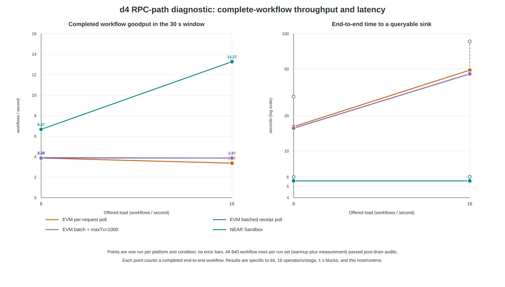

# d4 RPC path diagnostic — 2026-10-27

## Scope and measurement

These are remote-host diagnostic runs for one four-stage chain (`d4`), with 16 operations per stage, one-second blocks, 256 sender accounts, a five-second warmup, and a 30-second measurement window at 8 and 16 offered workflows/s. They are single-run comparisons intended to diagnose the earlier EVM result; they are not a capacity study or a paper performance claim.

The counted unit is one complete end-to-end workflow, confirmed by a queryable sink and then checked against its transaction receipt(s), node events, and per-stage state. It is not the number of contract calls or receipts. Every run had 840 rows (120 warmup plus 720 measurement); all rows passed the post-drain audit. IDs and EVM transaction hashes were unique, and each workflow's pre-submit sink was empty.

## Results

| Run | Offered 8/s | Offered 16/s | p50 / p95 at 16/s | 16/s drain after window | Audited rows |
|---|---:|---:|---:|---:|---:|
| EVM, per-workflow 200 ms receipt polling | 3.87 workflows/s | 3.37 workflows/s | 48.89 / 85.89 s | 90.1 s | 840/840 |
| EVM, centralized receipt batches (128 max) | 3.90 workflows/s | 3.87 workflows/s | 45.44 / 85.94 s | 90.3 s | 840/840 |
| EVM, batched polling plus explicit `--max-transactions 1000` | 3.87 workflows/s | 3.87 workflows/s | 45.40 / 85.96 s | 90.2 s | 840/840 |
| NEAR Sandbox, full receipt tree then sink query | 6.67 workflows/s | 13.27 workflows/s | 5.56 / 6.01 s | 5.9 s | 840/840 |

The graph shows window goodput and end-to-end seconds on the same axes. The 16/s measurement points count completed workflows within the 30-second window; the later drain is reported separately.

## What the run establishes

- The earlier EVM 3.6/s observation was not just a receipt-audit rejection artifact. After fixing the `0x` normalization bug, all 840 rows in each EVM run passed hash, signer, nonce, pre-state, event, and stage-state checks.
- Batching reduced the number of HTTP batch envelopes at 16/s to 988, compared with 44,259 individual receipt HTTP calls in the per-workflow-polling run. The batch contained about 100,000 receipt lookup items, so this reduced transport round trips rather than the number of individual receipt lookups. The receipt sampling bound was 213 ms (200 ms interval plus the measured maximum batch response time).
- Batched polling raised EVM's 16/s window goodput from 3.37 to 3.87 workflows/s and reduced mean Python-runner CPU during measurement/drain from about 101% to 25% of one core. Its p95 latency remained about 86 s and its drain remained about 90 s. This shows measurable client-side overhead, but batching alone does not explain the remaining backlog.
- In all three EVM runs, nonempty blocks contained exactly four workflow transactions; mean gas use was about 2.30M of 30M in those blocks (7.68%), and the sample-wide mean utilization was 6.49%. Pending transactions reached 222 in the per-request run and 256 in each batch run. The explicit `--max-transactions 1000` run reproduced the same block-count pattern and 16/s goodput. The four-transaction pattern therefore was not caused by the configured per-block transaction-count limit. Its cause remains unresolved.
- NEAR's 8/s and 16/s windows completed 200/240 and 398/480 workflows respectively. Every measured workflow had seven successful receipts, matching node events and state checks; median sink-queryable time stayed near 5.56 s. These are d4 Sandbox observations only.

The data do not support multiplying a performance result by the number of stages/contracts. They also do not yet support a general throughput advantage: one host/runtime, one d4 topology, and one repeat per diagnostic condition are insufficient for that claim.

## Reproduction records

- Per-request EVM raw: [`rpc_light_d4_r6/rpc_light_d4_r6_evm_raw.json`](rpc_light_d4_r6/rpc_light_d4_r6_evm_raw.json)
- Batched EVM raw: [`rpc_batch_d4_r8/rpc_batch_d4_r8_evm_raw.json`](rpc_batch_d4_r8/rpc_batch_d4_r8_evm_raw.json)
- Explicit max-transactions EVM raw: [`anvil_max1000_d4_r10/anvil_max1000_d4_r10_evm_raw.json`](anvil_max1000_d4_r10/anvil_max1000_d4_r10_evm_raw.json)
- NEAR raw: [`rpc_light_d4_r6/rpc_light_d4_r6_near_raw.json`](rpc_light_d4_r6/rpc_light_d4_r6_near_raw.json)
- SVG generator: [`plot_rpc_diagnostic.py`](plot_rpc_diagnostic.py)
- Saved remote launcher: [`launch_remote_evm_stress.sh`](../launch_remote_evm_stress.sh)

The EVM runs used Anvil 1.8.6, Solidity 0.8.24, 30M block gas limit, and one-second blocks. The last run set the per-block transaction maximum explicitly to 1000; Foundry documents this option as the maximum number of transactions in a block ([Anvil configuration reference](https://foundry-rs.github.io/foundry/anvil/struct.NodeConfig.html)). The NEAR run used near-sandbox 2.14.0. Raw JSONs include effective schedules, timestamps, RPC method counts, and block data; adjacent CSVs record host, runner, and engine CPU/RSS samples.

## Remaining experiment scope

No new d2, d8, 8-stage, or 20-stage run is included here. Those comparisons should count one completed workflow each and plot seconds against dependency depth and offered load; batch/one-contract or same-domain controls must be included before interpreting depth effects. The d4 diagnostic neither validates nor predicts a 20-stage result.
